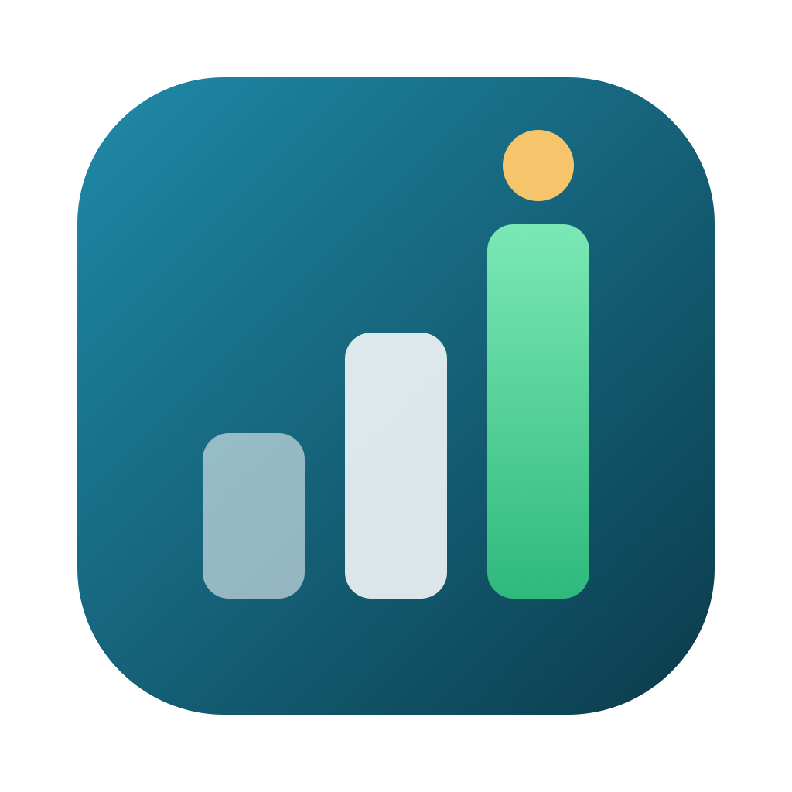
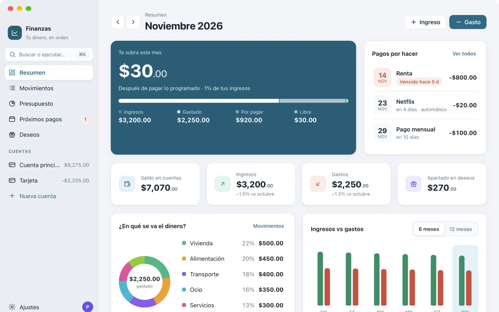
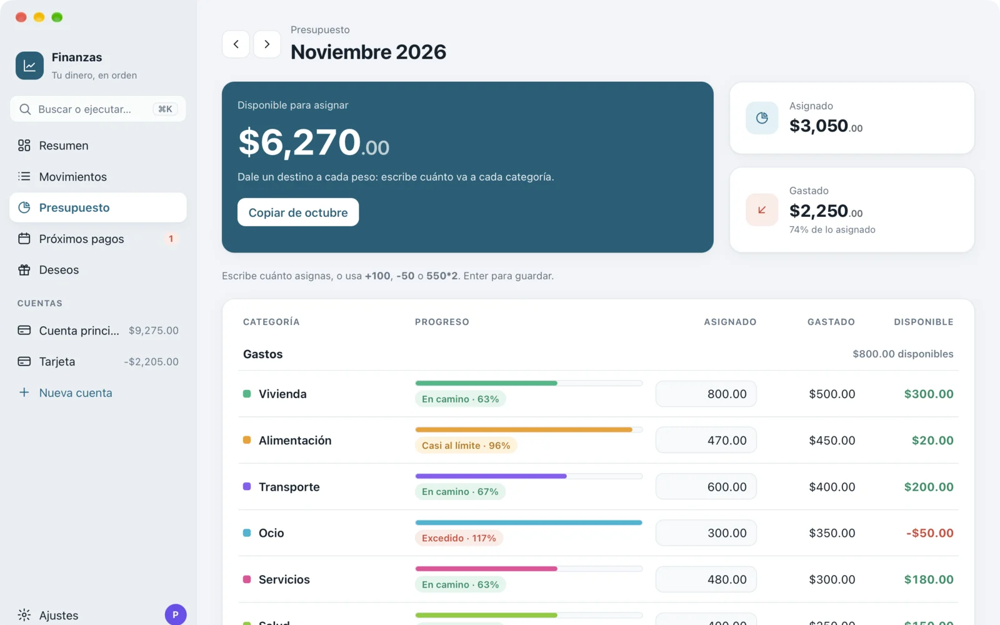
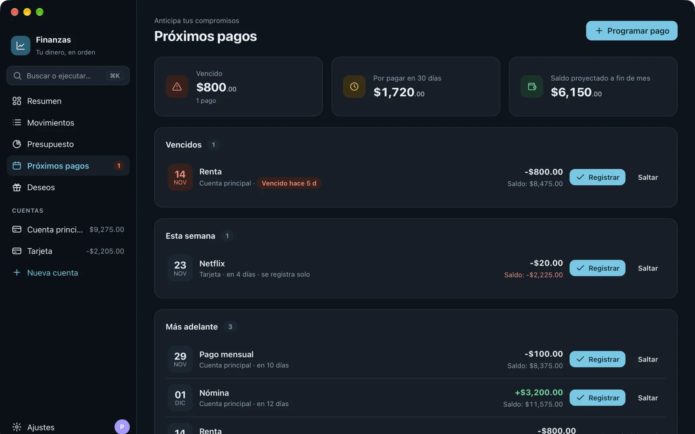

<p align="center"></p>

# Finanzas

[](https://github.com/Leoglez10/finanzas/releases/latest)
[](https://github.com/Leoglez10/finanzas/actions/workflows/rust.yml)
[](https://github.com/Leoglez10/finanzas/actions/workflows/release.yml)
[](https://github.com/Leoglez10/finanzas/releases)
[](https://leoglez10.github.io/finanzas/)

Local personal finance app for macOS, Windows and Linux, built with [Tauri](https://tauri.app) (Rust core, Svelte interface).
See at a glance how much money is left this month, plan envelope budgets, never miss a scheduled
payment, and let AI assistants read and record your finances through MCP.
The interface is in Spanish. Website: **[leoglez10.github.io/finanzas](https://leoglez10.github.io/finanzas/)**.

<p align="center"></p>

Everything stays on your computer: no account, cloud or telemetry.

## Contents

- [Quick start](#quick-start)
- [Features](#features)
- [Using the app](#using-the-app)
- [Install](#install)
- [Data location and backups](#data-location-and-backups)
- [MCP server](#mcp-server)
- [Import](#import)
- [Troubleshooting](#troubleshooting)
- [Limitations](#limitations)
- [Development](#development)
- [Releasing](#releasing)
- [Legacy Swift app](#legacy-swift-app)

## Quick start

1. Download the installer for your system from the [Install](#install) table (always the latest release).
2. Open **Finanzas** and follow **Primeros pasos** on the Resumen: create an account, record your income, assign it in Presupuesto.
3. Add recurring bills in **Próximos pagos** so the projected balance knows what is still due.

## Features

- **Resumen** — the selected month at a glance: how much is left after scheduled payments (Gastado / Por pagar / Libre),
  payments due, income and expenses against last month, money set aside for wishes, spending by category and
  income vs expenses for 6 or 12 months. Every chart column and category opens its movements.
  A **Primeros pasos** checklist guides a new database.
- **Movimientos** — all accounts or one, grouped by day, with search, type and month/category filters.
  Double-click an amount or a category to change it in place.
- **Presupuesto** — monthly envelope budget: type an amount, `+100` / `-50` to add or subtract, or math such as `550*2`;
  copy last month's amounts; each category shows its progress and whether it is on track, close or over.
- **Próximos pagos** — overdue, this week and later payments with projected balances; register or skip each one,
  and schedule recurring payments that can register themselves.
- **Deseos** — set money aside for things you want to buy without recording an expense (see [Wishes](#wishes-and-savings-goals)).
- **Undo instead of "are you sure?"** — deleting, registering, importing or editing shows **Deshacer** (or press ⌘Z).
  Only deleting a whole profile asks first, because it removes its database.
- **Command palette (⌘K)** — commands, payees, `uber 120 ayer` to record a movement, `apartar 200 playstation`, themes and profiles.
- **Quick capture (⌥⇧F)** — a small window from any app: type `super 450.50 tarjeta`, press Enter. Payee spelling,
  category and account come from your own history.
- **CSV import** — drop a bank CSV on the window (or ⌘I): comma or semicolon files, Spanish or English headers and
  separate cargo/abono columns, with a preview that marks duplicates and broken rows. All rows or none are imported.
- **Menu-bar icon and reminders** — balance and next payment in the menu bar; system notifications before each payment
  arrive while Finanzas runs (closing the window keeps it in the menu bar).
- **Ajustes** — profiles (separate data, for example personal and business), six color themes with light/dark mode,
  reminders, import, database location, MCP agents and updates.
- A local **MCP server** for AI assistants (see [MCP server](#mcp-server)).

<p align="center">
  
  
</p>

## Using the app

Keyboard shortcuts (⌘ on macOS, Ctrl on Windows and Linux); they are also listed in **Ajustes › Atajos**:

| Shortcut | Action |
|---|---|
| ⌘K | Command palette |
| ⌥⇧F | Quick capture, from any app |
| ⌘N / ⇧⌘N | New expense / new income |
| ⌘1 … ⌘5 | Resumen, Movimientos, Presupuesto, Próximos pagos, Deseos |
| ⌘, | Ajustes |
| ⌘F | Search movements |
| ⌘I | Import a CSV |
| ⌘Z | Undo the last change |
| ⇧⌘L | Switch light / dark |
| Esc | Close a dialog or cancel an edit |

## Install

These links always download the latest release ([all releases](https://github.com/Leoglez10/finanzas/releases)):

| Platform | Download | Notes |
|---|---|---|
| macOS 11+ (Apple Silicon) | [Finanzas-macos-arm64.dmg](https://github.com/Leoglez10/finanzas/releases/latest/download/Finanzas-macos-arm64.dmg) | Drag Finanzas to Applications; the first time, right-click the app and choose Open. |
| Windows 10/11 (x64) | [Finanzas-windows-x64-setup.exe](https://github.com/Leoglez10/finanzas/releases/latest/download/Finanzas-windows-x64-setup.exe) | If SmartScreen appears, choose More info → Run anyway. |
| Linux (Debian/Ubuntu, x86_64) | [finanzas-linux-amd64.deb](https://github.com/Leoglez10/finanzas/releases/latest/download/finanzas-linux-amd64.deb) | `sudo apt install ./finanzas-linux-amd64.deb` |
| Linux (other, x86_64) | [Finanzas-linux-x86_64.AppImage](https://github.com/Leoglez10/finanzas/releases/latest/download/Finanzas-linux-x86_64.AppImage) | `chmod +x` and run; updates itself. A plain [tar.gz](https://github.com/Leoglez10/finanzas/releases/latest/download/finanzas-linux-x86_64.tar.gz) of the binaries is also published. |

**macOS with Homebrew** (this repository is its own tap; also links `finanzas-mcp` into your `PATH`):

```sh
brew tap leoglez10/finanzas https://github.com/Leoglez10/finanzas
brew trust leoglez10/finanzas   # recent Homebrew asks to trust third-party taps
brew install --cask finanzas
```

**Updates:** Finanzas checks GitHub Releases when it opens (turn it off in *Ajustes › Actualizaciones*). When there is
a new version, the sidebar offers **Instalar actualización**; it downloads, verifies the signature and asks to restart.
Homebrew installs the app but leaves updates to it (`auto_updates true`); `brew upgrade --greedy` still works.
The `.deb` and the tar.gz do not update themselves; reinstall them from this table.

The installers are not signed by Apple or Microsoft. Each one also ships the MCP server (`finanzas-mcp`).
Your data lives outside the app (see below), so reinstalling or upgrading keeps it.

**Uninstall:** macOS, drag `Finanzas.app` to the Trash; Windows, *Settings › Apps*; Debian/Ubuntu,
`sudo apt remove finanzas`. None of these delete your database.

### Requirements to build from source

- Rust stable, Node.js 24 and pnpm 11.
- Platform dependencies:

| Platform | Dependencies |
|---|---|
| macOS | Xcode Command Line Tools (`xcode-select --install`) |
| Windows | Microsoft C++ Build Tools (Desktop development with C++) and WebView2 (included in Windows 11) |
| Debian/Ubuntu | `libwebkit2gtk-4.1-dev libayatana-appindicator3-dev librsvg2-dev libxdo-dev libssl-dev` |

### From source

```sh
bash scripts/dev.sh      # hot reload; FINANZAS_DB=<path> uses another database
bash scripts/build.sh    # release bundles in target/release/bundle/
```

## Data location and backups

The app and MCP server share one SQLite database (WAL mode). Set `FINANZAS_DB` to use a different file;
otherwise the default is the platform data directory. That file is the **Personal** profile. Other profiles
(create, switch, rename, hide or delete them in **Ajustes › Perfil**) are `<name>.db` files in the
same folder, and settings are shared. Deleting a profile removes its file permanently; Personal cannot be deleted.

| Platform | Default database |
|---|---|
| macOS | `~/Library/Application Support/Finanzas/finanzas.db` |
| Windows | `%APPDATA%\Finanzas\finanzas.db` |
| Linux | `~/.local/share/Finanzas/finanzas.db` (or `$XDG_DATA_HOME/Finanzas/finanzas.db`) |

**Backup:** close the app and any MCP client using it, then copy `finanzas.db` (and `finanzas.db-wal` /
`finanzas.db-shm` if present). **Restore:** with the app closed, put the copies back in the same folder.
**Ajustes › Datos** shows which database the app is using.

## Wishes and savings goals

Open **Deseos** to save a purchase with its target price, product link, details and expense category.
Reserve part or all of the price from available category funds; set the reservation to zero to release it.
The app explains budget fit, missing funds and recorded upcoming-payment constraints separately.
Reservations do not create expenses or move account balances, and cannot claim the same category funds twice.
Archive a wish to release funds and keep its history; or use **Lo compré** to record the expense and archive it in one step.

See [reservation and evaluation rules](docs/wishes.md), including unknown results, the 30-day horizon,
and the automatic version 1 → 2 database migration. Back up before upgrading; older binaries cannot open version 2.

## MCP server

`finanzas-mcp` is a stdio MCP server over the same database. It works while the app is closed.
Point your MCP client at the installed binary:

| Platform | Command path |
|---|---|
| macOS | `/Applications/Finanzas.app/Contents/MacOS/finanzas-mcp` |
| Windows | `%LOCALAPPDATA%\Programs\Finanzas\finanzas-mcp.exe` |
| Linux (.deb) | `/usr/bin/finanzas-mcp` |
| From source | `target/release/finanzas-mcp` after `cargo build --release -p finanzas-mcp` |

```json
{
  "mcpServers": {
    "finanzas": { "command": "/Applications/Finanzas.app/Contents/MacOS/finanzas-mcp" }
  }
}
```

Optionally set `FINANZAS_DB` in the client's environment to use the same non-default database as the app.
Amounts are decimal currency units (negative for outflows); dates use `YYYY-MM-DD` and months use `YYYY-MM`.
**Ajustes → Agentes MCP** shows Claude, Codex and OpenCode with a green dot while that client has the server running
(the server refreshes `mcp-clients/<agent>` beside the database every 30 s), and copies each client's setup.
Every tool accepts an optional `perfil` (default `personal`, or the name of a profile created in the app, such as `negocio`) to choose which profile's data it uses.

| Tool | Purpose |
|---|---|
| `list_wishes` | List active wishes and evaluations (`includeArchived` optional) |
| `save_wish` | Create or replace details (`id` optional, `name` and `price` required) |
| `reserve_wish` | Set an absolute reservation (`id`, `amount`; zero releases funds) |
| `archive_wish` | Archive a wish and release funds (`id`) |
| `evaluate_wish` | Explain budget fit and 30-day cash shortfalls (`id`) |
| `list_accounts` | List accounts and balances |
| `get_transactions` | Query transactions |
| `list_categories` | List category groups and categories |
| `get_budget_month` | Get a monthly envelope budget |
| `spending_by_category` | Summarize outflows by category |
| `add_transaction` | Add a transaction |
| `update_transaction` | Update a transaction |
| `delete_transaction` | Delete a transaction |
| `set_budget_amount` | Assign a monthly category amount |
| `list_schedules` | List scheduled payments |
| `skip_schedule` | Skip a scheduled payment |
| `get_upcoming` | Get upcoming payments and projected balances |

## Import

**Bank CSV:** drop the file on the window, press ⌘I, or use *Movimientos › Importar CSV* or *Ajustes › Datos*.
Pick the account; the preview marks duplicates (same day, payee and amount in that account) and rows that
cannot be read. Nothing is written until you confirm, and **Deshacer** removes the whole import.

**Another finance app:** *Ajustes › Datos* copies data into an empty profile. **Desde Actual Budget** accepts
`db.sqlite` or a backup `.zip`; **Desde la app anterior de Mac** reads the old SwiftData store
(`~/Library/Application Support/Finanzas/Finanzas.store`) read-only.

## Troubleshooting

| Problem | What to do |
|---|---|
| macOS says the app "cannot be opened" or is from an unidentified developer | Right-click `Finanzas.app` › Open once (the app is not notarized). |
| Windows SmartScreen blocks the installer | More info › Run anyway. |
| Linux: the window does not open | Install WebKitGTK 4.1 (`libwebkit2gtk-4.1-0`), or use the AppImage. |
| "No se pudo abrir la base de datos" | Check that the folder in [Data location](#data-location-and-backups) is writable, or that `FINANZAS_DB` points to a valid path. |
| Import refuses to run | Import only works into an empty database; use a new `FINANZAS_DB` file or start fresh. |
| MCP client sees different data than the app | Both must use the same database: set the same `FINANZAS_DB` in both, or neither. |

## Limitations

- Installers are not signed by Apple or Microsoft; macOS builds are Apple Silicon only and Linux builds are x86_64 only.
- Reminders and automatic payments run while Finanzas is open (the menu-bar icon keeps it running with the window closed).
- Single user, single device: there is no sync between computers.
- The interface is Spanish only; amounts are shown as `$1,234.56`.

## Development

```sh
FINANZAS_DB=$(mktemp -d)/test.db cargo test --workspace --exclude finanzas-desktop
cargo clippy --workspace --all-targets -- -D warnings
pnpm --dir desktop check && pnpm --dir desktop test     # types and the CSV / quick-capture parsers
```

Always run tests with `FINANZAS_DB` pointing at a scratch file. To look at the app with demo data:

```sh
(cd desktop/src-tauri && cargo run --example demo_db -- /tmp/finanzas-demo/finanzas.db)
FINANZAS_DB=/tmp/finanzas-demo/finanzas.db bash scripts/dev.sh
```

`desktop/qa/` holds scripts that drive the real app on a throwaway demo database (debug builds only):
start `pnpm --dir desktop dev`, then run `desktop/qa/run.sh desktop/qa/movimientos.js`; it prints PASS/FAIL
lines and exits non-zero on a failure. They never touch your data.

| Path | Contents |
|---|---|
| `crates/finanzas-core` | Domain, SQLite store, services and importers |
| `crates/finanzas-mcp` | MCP stdio server |
| `desktop/src-tauri` | Tauri app: commands over finanzas-core, menu, menu-bar icon, reminders, updater |
| `desktop/src` | Svelte interface (`screens/`, `components/`, `lib/` state, parsers and formatting) |
| `desktop/qa` | Scripts that drive the real app |
| `design/redesign` | The approved interface prototype |
| `packaging/icon` | App icon source (`finanzas.svg`, `finanzas-1024.png`) |
| `scripts/` | `dev.sh`, `build.sh` |
| `site/` | Project website (GitHub Pages), built with the [taste-skill](https://github.com/Leonxlnx/taste-skill) kit (MIT, files in `site/assets/`) |
| `.github/workflows/` | `rust.yml` tests on every push and PR; `release.yml` installers, update feed and releases; `pages.yml` website |

## Releasing

Releases are automatic: bump `version` in the root `Cargo.toml` and merge to `main`.
`release.yml` sees that `v<version>` has no release yet, builds the installers on macOS, Windows and Linux,
creates the tag, publishes the GitHub Release with a signed `latest.json` for the in-app updater, and points the
Homebrew cask at the new `.dmg`. Pushing a `v*` tag by hand also works; pull requests that touch the desktop
bundle build the installers as artifacts without publishing.

Update signatures need the repository secrets `TAURI_SIGNING_PRIVATE_KEY` (the key file's contents) and
`TAURI_SIGNING_PRIVATE_KEY_PASSWORD` (empty if the key has none). The public key is in
`desktop/src-tauri/tauri.conf.json`; losing the private key means existing installs can no longer update.
`bash scripts/build.sh` makes the same bundles locally. The website in `site/` is published by `pages.yml`
whenever `site/` changes on `main`.

## Legacy Swift app

The SwiftUI app under `Finanzas/`, `FinanzasKit/` and `FinanzasMCP/` still builds with the old
macOS instructions until it is removed. It requires macOS 15+, Xcode 16+ and XcodeGen:

```sh
xcodegen
xcodebuild -project Finanzas.xcodeproj -scheme Finanzas -configuration Release -derivedDataPath build build
cp -R build/Build/Products/Release/Finanzas.app /Applications/
swift test --package-path FinanzasKit
```

Its store is `~/Library/Application Support/Finanzas/Finanzas.store`; `FINANZAS_STORE` overrides it.
The ad-hoc signed app may require right-click › Open on first launch.

## Built with
[](https://github.com/Gentleman-Programming/gentle-ai)

## License

[MIT](LICENSE)
