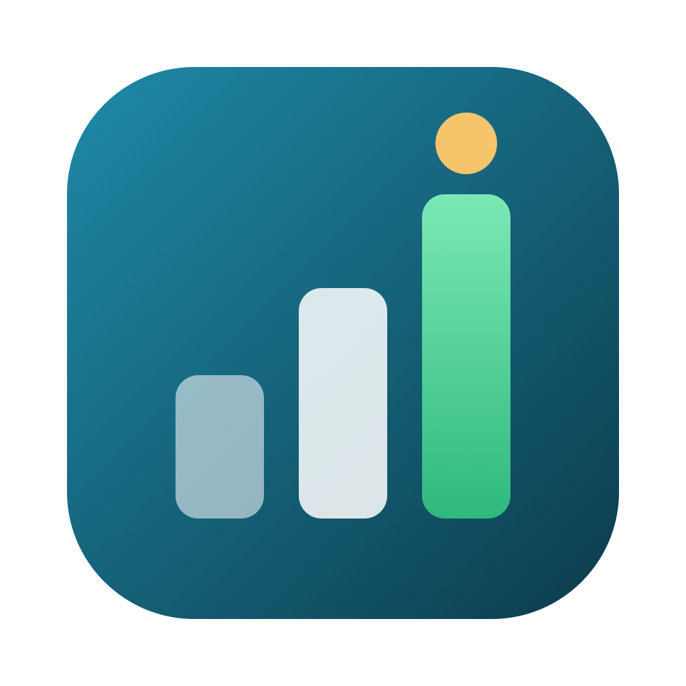
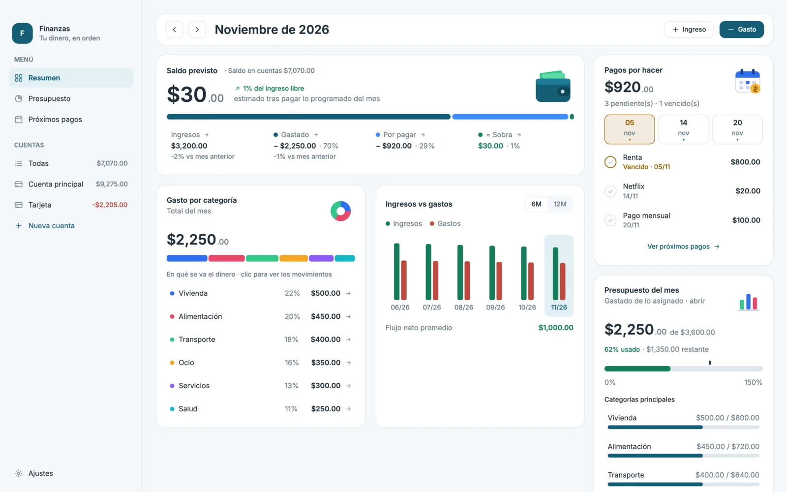
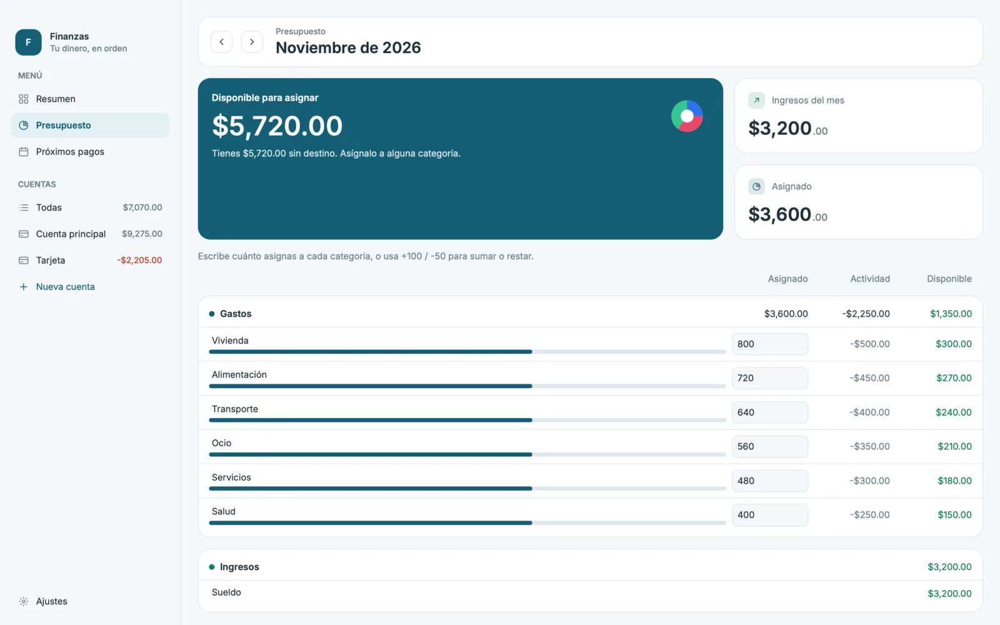
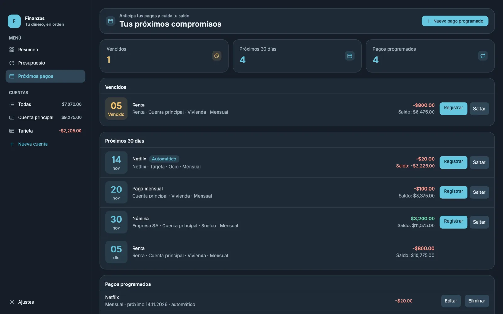

<p align="center"></p>

# Finanzas

[](https://github.com/Leoglez10/finanzas/releases/latest)
[](https://github.com/Leoglez10/finanzas/actions/workflows/rust.yml)
[](https://github.com/Leoglez10/finanzas/actions/workflows/release.yml)
[](https://github.com/Leoglez10/finanzas/releases)
[](https://leoglez10.github.io/finanzas/)

Local personal finance app for macOS, Windows and Linux, built in Rust with the [Rune](https://github.com/anomalyco/rune) GPU UI framework.
See at a glance how much money is left this month, plan envelope budgets, never miss a scheduled
payment, and let AI assistants read and record your finances through MCP.
The interface is in Spanish. Website: **[leoglez10.github.io/finanzas](https://leoglez10.github.io/finanzas/)**.

<p align="center"></p>

Everything stays on your computer: no account, cloud or telemetry.

## Contents

- [Quick start](#quick-start)
- [Features](#features)
- [Using the app](#using-the-app)
- [Install](#install)
- [Data location and backups](#data-location-and-backups)
- [MCP server](#mcp-server)
- [Import](#import)
- [Troubleshooting](#troubleshooting)
- [Limitations](#limitations)
- [Development](#development)
- [Releasing](#releasing)
- [Legacy Swift app](#legacy-swift-app)

## Quick start

1. Download the installer for your system from the [Install](#install) table (always the latest release).
2. Open **Finanzas** and follow **Primeros pasos** on the Resumen: create an account, record your income, assign it in Presupuesto.
3. Add recurring bills in **Próximos pagos** so the projected balance knows what is still due.

## Features

- **Resumen** — a card dashboard for the selected month:
  - **Saldo previsto**: income minus what is already spent and what scheduled payments still take,
    shown as one stacked bar (Gastado / Por pagar / Sobra) with month-over-month changes and the total account balance.
  - **Pagos por hacer**: outflows still due this month, overdue ones highlighted, grouped by day chips.
  - **Gasto por categoría**, **Ingresos vs gastos** (6 or 12 months), **Presupuesto del mes** with a 100% marker,
    and **Movimientos recientes**.
  - Payment reminders and a **Primeros pasos** checklist for a new database.
- **Presupuesto** — monthly envelope budget: assign amounts per category (type a number, or `+100` / `-50`
  to add or subtract), see activity, availability and how much is left to assign.
- **Próximos pagos** — scheduled payments for the next 30 days with projected account balances;
  register (Registrar) or skip (Saltar) each occurrence; recurring schedules can register themselves (automatic).
- **Movimientos** — searchable ledger for all accounts or one account; add, edit and delete income and expenses.
- **Cuentas** — on-budget and off-budget accounts with balances in the sidebar; closed accounts listed separately.
- **Ajustes** — payment reminders (days before and hour), import from the old Finanzas app or Actual, database location.
- Light and dark mode follow the system.
- A local **MCP server** for AI assistants (see [MCP server](#mcp-server)).

<p align="center">
  
  
</p>

## Using the app

Almost everything on the Resumen is clickable, shows a tooltip on hover and gives press feedback:

| Click | Result |
|---|---|
| Month name (when not on the current month) or arrows | Go back to the current month / previous / next month |
| **Ingreso** / **Gasto** | Record an income or expense |
| Legend items in Saldo previsto | Ingresos and Gastado open Movimientos; Por pagar opens Próximos pagos; Sobra opens Presupuesto |
| Circle next to a payment in Pagos por hacer | **Registers that payment today** (same as Registrar in Próximos pagos) |
| Day chip in Pagos por hacer | Show only that day's payments; click again to show all |
| Category row or bar segment | Movimientos filtered by that category |
| Chart column | Open that month |
| Budget card header / category | Open Presupuesto / that category's movements |
| Recent movement | Movimientos searching that payee |
| Reminders title | Collapse or expand the reminders |

Elsewhere: double-click a movement or a scheduled payment to edit it; right-click a movement for Editar / Eliminar;
click a category name in Presupuesto to see its movements. **Todas** in the sidebar clears the search.

Keyboard shortcuts (⌘ on macOS, Ctrl on Windows and Linux):

| Shortcut | Where | Action |
|---|---|---|
| ⌘N / ⇧⌘N | Movimientos | New expense / new income |
| ⌘N | Próximos pagos | New scheduled payment |
| Delete | Movimientos, Próximos pagos | Delete the selected item (asks first) |
| ⌘← / ⌘→ | Resumen, Presupuesto | Previous / next month |
| ⌘, | Anywhere | Ajustes |
| Esc | Sheets and dialogs | Close |

## Install

These links always download the latest release ([all releases](https://github.com/Leoglez10/finanzas/releases)):

| Platform | Download | Notes |
|---|---|---|
| macOS 11+ (Apple Silicon) | [Finanzas-macos-arm64.dmg](https://github.com/Leoglez10/finanzas/releases/latest/download/Finanzas-macos-arm64.dmg) | Drag Finanzas to Applications; the first time, right-click the app and choose Open. |
| Windows 10/11 (x64) | [Finanzas-windows-x64-setup.exe](https://github.com/Leoglez10/finanzas/releases/latest/download/Finanzas-windows-x64-setup.exe) | Installs for the current user in `%LOCALAPPDATA%\Programs\Finanzas`; if SmartScreen appears, choose More info → Run anyway. |
| Linux (Debian/Ubuntu, x86_64) | [finanzas-linux-amd64.deb](https://github.com/Leoglez10/finanzas/releases/latest/download/finanzas-linux-amd64.deb) | `sudo apt install ./finanzas-linux-amd64.deb` |
| Linux (other, x86_64) | [finanzas-linux-x86_64.tar.gz](https://github.com/Leoglez10/finanzas/releases/latest/download/finanzas-linux-x86_64.tar.gz) | Extract and run `./finanzas`. |

**macOS with Homebrew** (this repository is its own tap; also links `finanzas-mcp` into your `PATH`):

```sh
brew tap leoglez10/finanzas https://github.com/Leoglez10/finanzas
brew trust leoglez10/finanzas   # recent Homebrew asks to trust third-party taps
brew install --cask finanzas
brew upgrade finanzas   # later, to update
```

**Updates:** the app checks GitHub for a newer release when it opens and once a day. When there is one,
*Resumen* shows a notice with a download link (or `brew upgrade finanzas`), and after updating it shows
which version you are on with a link to its release notes. *Ajustes › Versión* shows the installed version.
The check needs `curl` (bundled with macOS and Windows 10+); offline, the app stays quiet.

The installers are not signed yet. Each one also ships the MCP server (`finanzas-mcp`).
Your data lives outside the app (see below), so reinstalling or upgrading keeps it.

**Uninstall:** macOS, drag `Finanzas.app` to the Trash; Windows, *Settings › Apps*; Debian/Ubuntu,
`sudo apt remove finanzas`. None of these delete your database.

### Requirements to build from source

- Rust stable (the app crate uses edition 2024).
- Platform dependencies:

| Platform | Dependencies |
|---|---|
| macOS | Xcode Command Line Tools (`xcode-select --install`) |
| Windows | Microsoft C++ Build Tools with Desktop development with C++ |
| Debian/Ubuntu | Build: `libxkbcommon-dev`, `libwayland-dev`. Run: `libxkbcommon-x11-0` and a Vulkan driver (`mesa-vulkan-drivers` without a GPU) |

The file dialogs used by import go through the XDG desktop portal on Linux.

### From source

```sh
cargo run --release -p finanzas-app      # or: bash scripts/dev.sh
```

## Data location and backups

The app and MCP server share one SQLite database (WAL mode). Set `FINANZAS_DB` to use a different file;
otherwise the default is the platform data directory:

| Platform | Default database |
|---|---|
| macOS | `~/Library/Application Support/Finanzas/finanzas.db` |
| Windows | `%APPDATA%\Finanzas\finanzas.db` |
| Linux | `~/.local/share/Finanzas/finanzas.db` (or `$XDG_DATA_HOME/Finanzas/finanzas.db`) |

**Backup:** close the app and any MCP client using it, then copy `finanzas.db` (and `finanzas.db-wal` /
`finanzas.db-shm` if present). **Restore:** with the app closed, put the copies back in the same folder.
The **Ajustes** screen shows which database the app is using.

## MCP server

`finanzas-mcp` is a stdio MCP server over the same database. It works while the app is closed.
Point your MCP client at the installed binary:

| Platform | Command path |
|---|---|
| macOS | `/Applications/Finanzas.app/Contents/MacOS/finanzas-mcp` |
| Windows | `%LOCALAPPDATA%\Programs\Finanzas\finanzas-mcp.exe` |
| Linux (.deb) | `/usr/bin/finanzas-mcp` |
| From source | `target/release/finanzas-mcp` after `cargo build --release -p finanzas-mcp` |

```json
{
  "mcpServers": {
    "finanzas": { "command": "/Applications/Finanzas.app/Contents/MacOS/finanzas-mcp" }
  }
}
```

Optionally set `FINANZAS_DB` in the client's environment to use the same non-default database as the app.
Amounts are decimal currency units (negative for outflows); dates use `YYYY-MM-DD` and months use `YYYY-MM`.

| Tool | Purpose |
|---|---|
| `list_accounts` | List accounts and balances |
| `get_transactions` | Query transactions |
| `list_categories` | List category groups and categories |
| `get_budget_month` | Get a monthly envelope budget |
| `spending_by_category` | Summarize outflows by category |
| `add_transaction` | Add a transaction |
| `update_transaction` | Update a transaction |
| `delete_transaction` | Delete a transaction |
| `set_budget_amount` | Assign a monthly category amount |
| `list_schedules` | List scheduled payments |
| `skip_schedule` | Skip a scheduled payment |
| `get_upcoming` | Get upcoming payments and projected balances |

## Import

**Ajustes › Importar datos** copies data into an empty database. **Importar desde Finanzas
(SwiftData)** reads the old app's store (`~/Library/Application Support/Finanzas/Finanzas.store`)
read-only, without modifying it. **Importar desde Actual** accepts `db.sqlite`, an export zip or a
server `.blob`. A confirmation names the source file and the destination database first.

## Troubleshooting

| Problem | What to do |
|---|---|
| macOS says the app "cannot be opened" or is from an unidentified developer | Right-click `Finanzas.app` › Open once (the app is not notarized). |
| Windows SmartScreen blocks the installer | More info › Run anyway. |
| Linux: the window does not open / Vulkan error | Install `mesa-vulkan-drivers` (and `libxkbcommon-x11-0`). |
| "No se pudo abrir la base de datos" | Check that the folder in [Data location](#data-location-and-backups) is writable, or that `FINANZAS_DB` points to a valid path. |
| Import refuses to run | Import only works into an empty database; use a new `FINANZAS_DB` file or start fresh. |
| MCP client sees different data than the app | Both must use the same database: set the same `FINANZAS_DB` in both, or neither. |

## Limitations

- Installers are unsigned; macOS builds are Apple Silicon only and Linux builds are x86_64 only (no AppImage yet).
- Single user, single device: there is no sync between computers.
- The interface is Spanish only; amounts are shown as `$1,234.56`.

## Development

```sh
cargo build --release -p finanzas-app -p finanzas-mcp   # or: bash scripts/build.sh
FINANZAS_DB=$(mktemp -d)/test.db cargo test --workspace
cargo clippy --workspace --all-targets -- -D warnings
```

Always run tests with `FINANZAS_DB` pointing at a scratch file. The app also renders headless with
in-memory demo data, for example `target/release/finanzas --scene demo-light --size 1440x900 --snap resumen.png`
(scenes include `demo-dark`, `presupuesto-light`, `proximos-dark`, `movimientos-light`, `ajustes-light`).

| Path | Contents |
|---|---|
| `crates/finanzas-core` | Domain, SQLite store, services and importers |
| `crates/finanzas-app` | Rune desktop app (`overview.rs` Resumen, `budget.rs`, `proximos.rs`, `ledger.rs`, `ajustes.rs`, `theme.rs` shared look and icons) |
| `crates/finanzas-mcp` | MCP stdio server |
| `packaging/` | App icon (`icon/finanzas.svg` source), macOS `Info.plist`, Windows Inno Setup script, Linux desktop entry |
| `scripts/` | `dev.sh`, `build.sh`, `package-macos.sh` |
| `site/` | Project website (GitHub Pages), built with the [taste-skill](https://github.com/Leonxlnx/taste-skill) kit (MIT, files in `site/assets/`) |
| `.github/workflows/` | `rust.yml` tests and builds on every push and PR; `release.yml` installers and releases; `pages.yml` website |

## Releasing

Releases are automatic: bump `version` in the root `Cargo.toml` and merge to `main`.
`release.yml` sees that `v<version>` has no release yet, builds the three installers, creates the tag
and publishes the GitHub Release. Pushing a `v*` tag by hand also works; pull requests that touch
packaging build the installers as artifacts without publishing.
`bash scripts/package-macos.sh <version>` builds the `.dmg` locally after a release build.
The website in `site/` is published by `pages.yml` whenever `site/` changes on `main`.

## Legacy Swift app

The SwiftUI app under `Finanzas/`, `FinanzasKit/` and `FinanzasMCP/` still builds with the old
macOS instructions until it is removed. It requires macOS 15+, Xcode 16+ and XcodeGen:

```sh
xcodegen
xcodebuild -project Finanzas.xcodeproj -scheme Finanzas -configuration Release -derivedDataPath build build
cp -R build/Build/Products/Release/Finanzas.app /Applications/
swift test --package-path FinanzasKit
```

Its store is `~/Library/Application Support/Finanzas/Finanzas.store`; `FINANZAS_STORE` overrides it.
The ad-hoc signed app may require right-click › Open on first launch.

## Built with
[](https://github.com/Gentleman-Programming/gentle-ai)

## License

[MIT](LICENSE)
